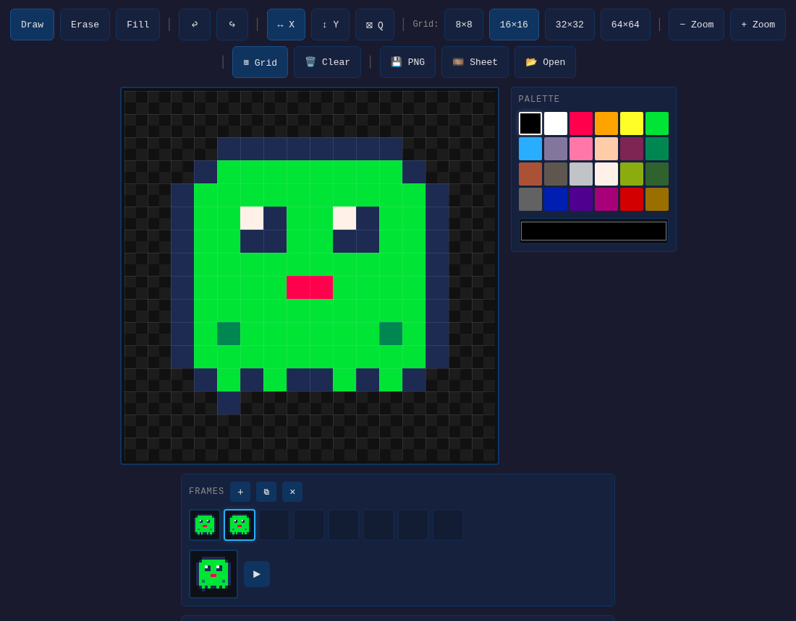

# Pixel Art Editor

A browser-based pixel art editor and sprite animator in a single HTML file, with no
dependencies and no build step. Open it and start drawing.



## Features

- **Tools**: pencil (with gap-free strokes via Bresenham lines), eraser and flood fill
- **Symmetry**: mirror horizontally, vertically or into all four quadrants while drawing
- **Animation**: up to 8 frames with add / duplicate / delete and a live preview
- **Undo / redo** per frame (50 steps)
- **Canvas sizes**: 8×8, 16×16, 32×32 and 64×64. Resizing keeps hard pixel edges
- **Zoom and pan**: mouse wheel (zooms toward the cursor), buttons, Ctrl+drag or middle mouse,
  pinch-to-zoom on touch screens
- **Import / export**: load a PNG, save the current frame as PNG, or export all frames as a
  sprite sheet
- **Palette** of 24 colors based on PICO-8, Game Boy and NES colors, plus a custom color picker
- Works with mouse, pen and touch; the layout adapts to small screens

## Keyboard shortcuts

| Shortcut | Action |
|----------|--------|
| B / E / F | Draw / erase / fill |
| Ctrl+Z | Undo |
| Ctrl+Y or Ctrl+Shift+Z | Redo |
| Ctrl+S | Save current frame as PNG |
| Mouse wheel | Zoom |
| Ctrl+drag / middle mouse | Pan |

## Run

Open `index.html` in a browser, or serve the folder:

```bash
git clone https://github.com/MinZziGOGOGO/pixelart.git
cd pixelart
python3 -m http.server 8000
```

## How it works

The image lives in a small off-screen canvas at its real resolution (e.g. 16×16 pixels).
The visible 512×512 canvas only *displays* it: it draws a checkerboard for transparency,
scales the image up with smoothing turned off and adds the grid lines on top. Mouse and
touch positions are converted back to grid coordinates, taking the zoom, the pan offset
and the CSS size of the canvas on small screens into account.

Each animation frame is its own off-screen canvas with its own undo and redo stacks, which
store `ImageData` snapshots taken before every stroke or fill.

## Tech stack

HTML5 Canvas · vanilla JavaScript · CSS
